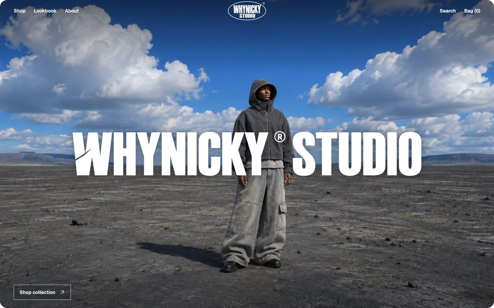
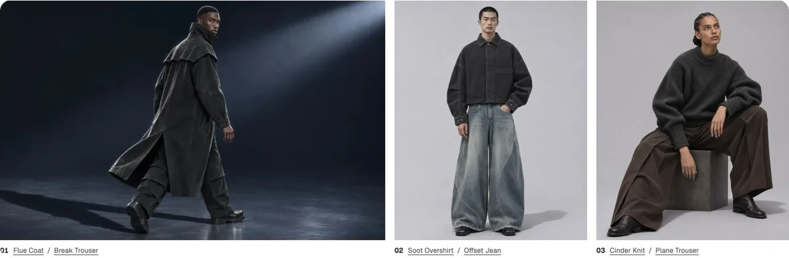
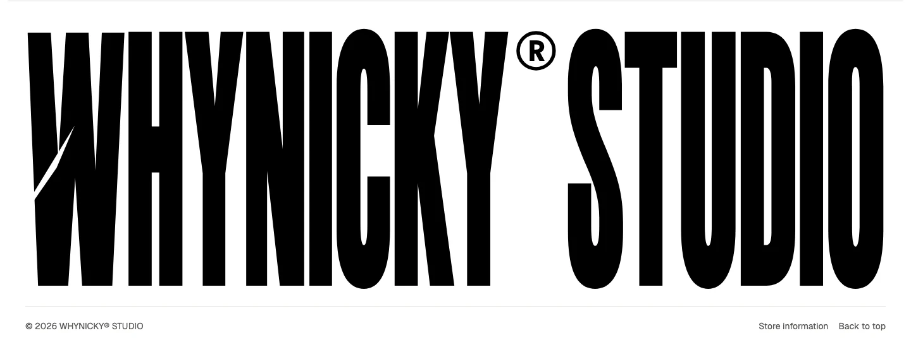

# WHYNICKY® STUDIO

**Fault Lines · Autumn / Winter 2026**

[](https://whynicky.github.io/WHYNICKY-STUDIO/)

A fashion storefront for a 24-piece menswear and unisex collection. Browse and filter the catalog, open garment details, or shop the looks in a 26-frame editorial. The demo bag remembers sizes and quantities in the current browser.

[Open the live site](https://whynicky.github.io/WHYNICKY-STUDIO/) · [Shop](https://whynicky.github.io/WHYNICKY-STUDIO/shop/) · [Lookbook](https://whynicky.github.io/WHYNICKY-STUDIO/lookbook/) · [Deployment](https://github.com/whynicky/WHYNICKY-STUDIO/actions/workflows/pages.yml)

## Studio fittings

The opening frame anchors the grid. Two portraits share its baseline on desktop and sit together beneath it on mobile. Each look links to the garments in the frame.



## Brand assets

The oval emblem pairs outlined lettering with a split W and a separate registered mark. The footer wordmark uses taller letter contours, with a stacked composition for smaller screens.



[Oval emblem](src/assets/brand-emblem.svg) · [Wide wordmark](src/assets/brand-wordmark-tall.svg) · [Stacked wordmark](src/assets/brand-wordmark-stacked.svg) · [Favicon](src/assets/favicon.svg) · [Image prompts](IMAGE-PROMPTS.md)

## Local development

Use Node.js 20 or later. The storefront is built with HTML, CSS, and JavaScript and has no package dependencies.

```sh
npm run dev
```

Open the address printed in the terminal. `npm run build` generates the static site in `dist/`. To preview with the GitHub Pages path, run the command below.

```sh
SITE_BASE_PATH=/WHYNICKY-STUDIO npm run dev
```

Product data lives in [collection.js](src/collection.js) and [new-pieces.js](src/new-pieces.js). The [editorial data](editorials.mjs) maps each photograph to the garments in that look. Prices and garment measurements are illustrative.

The [Pages workflow](.github/workflows/pages.yml) builds and deploys `dist/` on pushes to `main`. GitHub supplies the deployment path and origin, which the build uses for links, assets, and social images.
