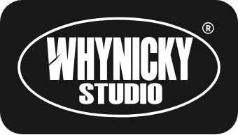
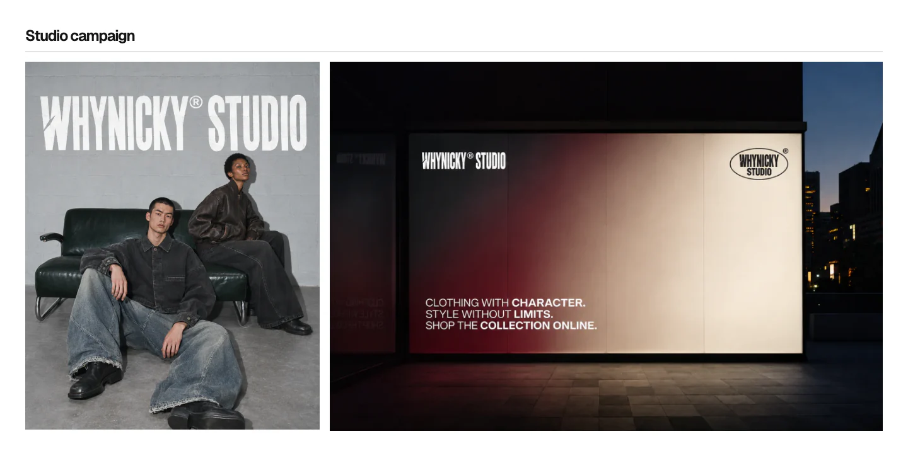
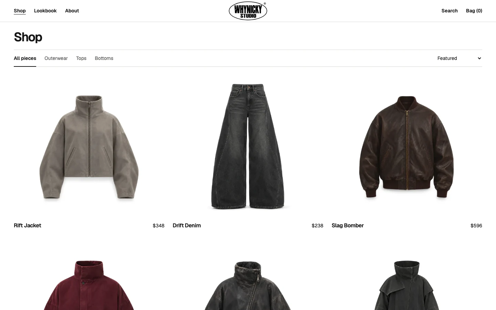
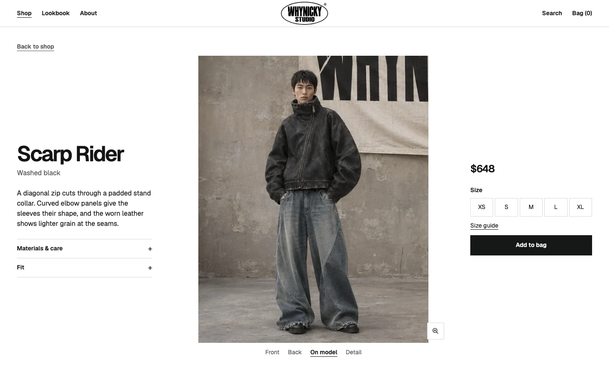
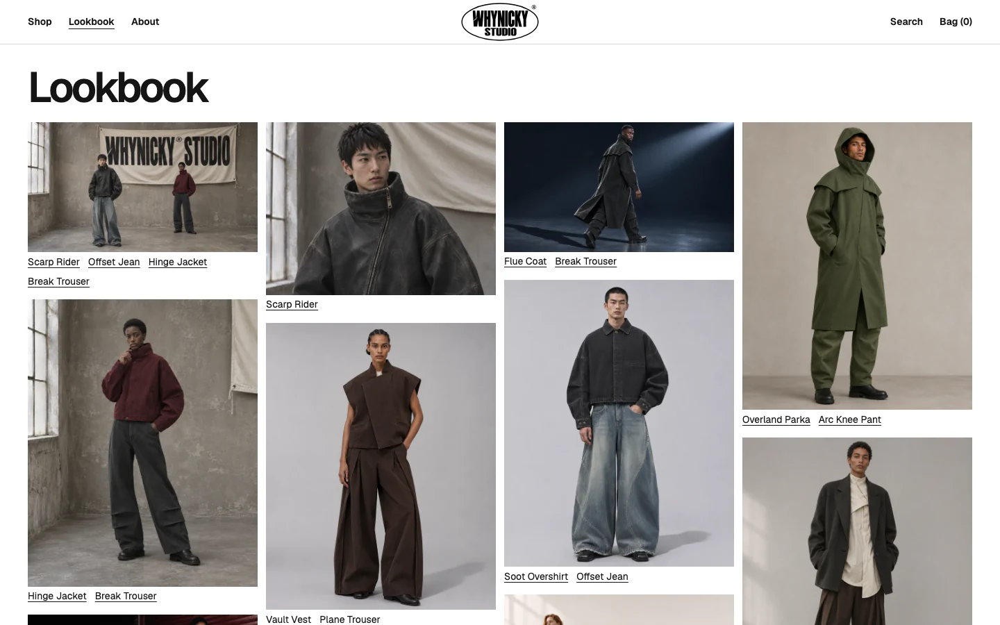
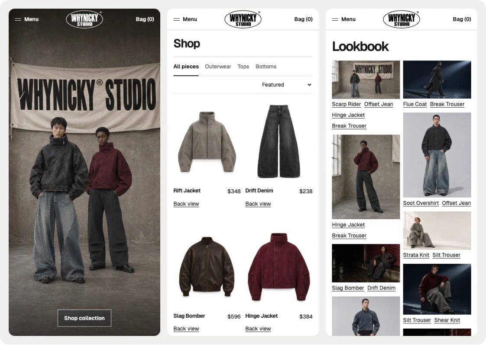

<p align="center">
  <a href="https://whynicky.github.io/WHYNICKY-STUDIO/">
    
  </a>
</p>

<h1 align="center">WHYNICKY® STUDIO</h1>

<p align="center">Fault Lines<br>Autumn / Winter 2026</p>

[](https://whynicky.github.io/WHYNICKY-STUDIO/)

<p align="center"><a href="https://whynicky.github.io/WHYNICKY-STUDIO/">Visit the storefront</a></p>

Fault Lines is a collection of 24 menswear and unisex pieces. Cropped jackets, curved denim seams and heavy knits give the collection its shape.

## Studio campaign

[](https://whynicky.github.io/WHYNICKY-STUDIO/#studio-campaign)


## Shop

Hover over a garment to see the back, or tap **Back view** on a phone. Product pages show the garment on a model, a close detail and the other pieces in the outfit.

<p align="center">
  <a href="https://whynicky.github.io/WHYNICKY-STUDIO/shop/"></a>
  <a href="https://whynicky.github.io/WHYNICKY-STUDIO/product/scarp-rider/"></a>
</p>

## Lookbook

Open any of the 20 photographs for a closer look. Links below each outfit take you to the pieces in the frame.

[](https://whynicky.github.io/WHYNICKY-STUDIO/lookbook/)

## On mobile



## Footer


## Run locally

Use Node.js 20 or later. The site has no package dependencies.

```sh
npm run dev
```

Open the address printed in the terminal. To build for the GitHub Pages path:

```sh
SITE_BASE_PATH=/WHYNICKY-STUDIO SITE_ORIGIN=https://whynicky.github.io npm run build
```

The static build goes to `dist/`. The [Pages workflow](.github/workflows/pages.yml) publishes it when `main` is updated. The bag is a browser demo with illustrative prices and measurements.
